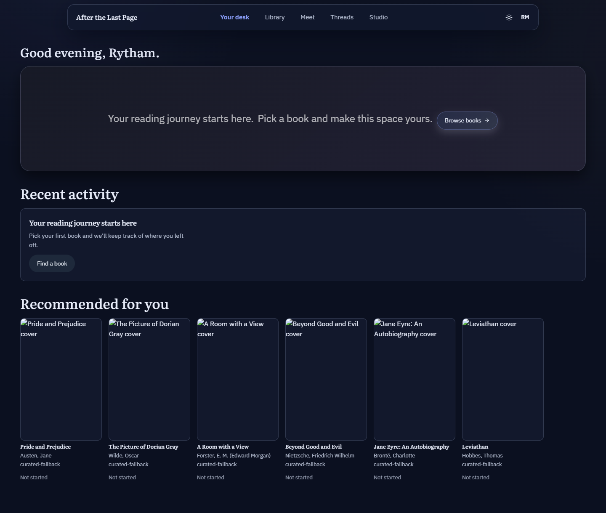
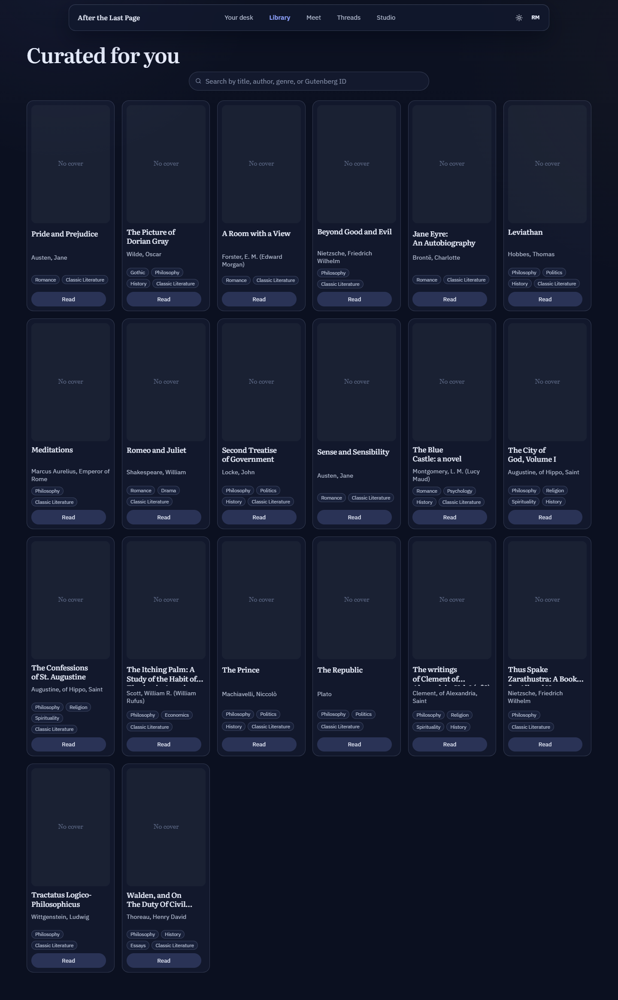

# ATLP Recommendations Engine

> Vector and collaborative book recommendation microservice powering [After The Last Page](https://github.com/V-Rytham/After-the-last-page).

This microservice handles book discovery for the ATLP platform. Instead of generic popularity rankings, it clusters books based on vector embeddings, genre affinity, and reader behavior—powering personalized discovery feeds on the reader's desk and in the library.

---

## Screenshots

### Recommended For You (Personal Reading Desk)


### Curated Library Feed


---

## Recommendation Strategies

1. **Genre Clustering & Affinity**: Matches reader's selected genres against catalog subject vectors to provide instant recommendations even for brand-new users (solving cold-start).
2. **Vector Similarity ("Books Like This")**: Computes cosine similarity across pre-embedded book representations to suggest conceptually similar literature.
3. **Collaborative Filtering**: Anchored to stable book keys (`source:sourceId`) to find patterns among readers who completed similar works.
4. **Resilient Fallback Mode**: If vector pipelines or heavy models are offline, the engine falls back to deterministic curated collections so the user experience is never interrupted.

---

## Tech Stack

- **Runtime**: Node.js (ES Modules)
- **Framework**: Express 5
- **Database**: MongoDB (Mongoose)
- **Embeddings & ML**: `@huggingface/transformers` / local vector workflows

---

## Setup & Local Run

### 1. Clone & Install
```bash
git clone https://github.com/V-Rytham/atlp-recommendations.git
cd atlp-recommendations
npm install
```

### 2. Configure Environment
```bash
cp .env.example .env
```
Fill in your `MONGODB_URI` and port (defaults to `5200`).

### 3. Start Service
```bash
npm start
```

---

## Endpoints

| Method | Endpoint | Description |
| :--- | :--- | :--- |
| `POST` | `/api/recommendations` | Recommendations based on genres & reading history |
| `POST` | `/api/recommendations/library` | Curated feed for library page |
| `POST` | `/api/recommendations/similar` | Books matching vector similarity |
| `POST` | `/api/recommendations/collaborative` | Collaborative suggestions for a specific book |

---

*Part of the **After The Last Page** ecosystem.*
